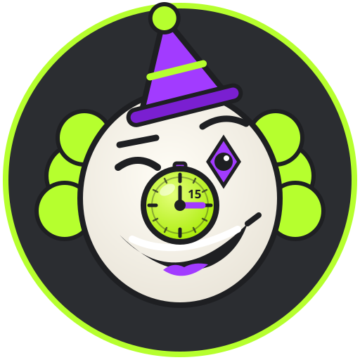

# 🤡⏰ Quarter Clown



Du bist mit Freunden in einem Discord-Videocall – und **alle 15 Minuten erscheint genau ein Meme**
aus eurem Call im gewählten Textkanal. Erstes Meme bei 15:00, zweites bei 30:00, drittes bei 45:00 …

- **Discord-Bot** (offiziell, Bot-Token, Slash-Commands): Setup, Zustimmung, Status, Posting
- **Windows-App** (Python, läuft lokal): Aufnahme des Discord-Fensters + Discord-Ton, Analyse, Meme-Rendering
- **Claude API** für die Caption – oder **lokaler Modus** mit Vorlagen ganz ohne API-Key

Keine User-Tokens, keine Client-Mods: Der Bot nutzt nur die offizielle Bot-API. Video und Ton nimmt die
Windows-App lokal von deinem Bildschirm/Audioausgang ab.

---

## 1. Bot in Discord anlegen und einladen

1. <https://discord.com/developers/applications> → **New Application** → Name „Quarter Clown“.
   Als App-Icon kannst du `quarter_clown/assets/logo.png` hochladen.
2. Links **Bot** → **Reset Token** → Token kopieren (kommt gleich in `.env`).
   *Privileged Gateway Intents* braucht es **keine** (alle drei bleiben aus).
3. Invite-Link öffnen (ersetze `DEINE_APP_ID` durch die *Application ID* von der Seite **General Information**):

   ```
   https://discord.com/oauth2/authorize?client_id=DEINE_APP_ID&scope=bot+applications.commands&permissions=117760
   ```

   `117760` = Kanal ansehen, Nachrichten senden, Links einbetten, Dateien anhängen, Nachrichtenverlauf lesen.
   Den fertigen Link zeigt dir auch die App (Button **Bot-Invite-Link öffnen**), sobald der Bot online ist.

## 2. Windows-App einrichten und starten

Voraussetzung: **Windows 11** und **Python 3.11 oder neuer** von <https://www.python.org/downloads/>
(bei der Installation „Add python.exe to PATH“ anhaken).

1. Ordner `quarter-clown` irgendwohin kopieren.
2. **`start.bat`** doppelklicken. Beim ersten Start werden eine virtuelle Umgebung und die Pakete
   installiert, und `.env` wird aus `.env.example` angelegt und im Editor geöffnet.
3. In `.env` eintragen:
   - `DISCORD_BOT_TOKEN=` – der Token aus Schritt 1
   - `ANTHROPIC_API_KEY=` – optional; leer = lokale Caption-Vorlagen
   - `DISCORD_GUILD_ID=` – optional, deine Server-ID: Slash-Commands erscheinen dann sofort
4. `start.bat` erneut starten.

### In Discord einrichten

```
/quarter setup voice:#Voice-Channel text:#memes [testkanal:#bot-test]
```

| Command | Wer | Was |
|---|---|---|
| `/quarter setup` | „Server verwalten“ oder Rolle **Quarter Clown Admin** | Voice-Channel, Meme-Kanal, optional Testkanal |
| `/quarter status` | alle | Aufnahmestatus, Countdown, Zustimmungen |
| `/quarter stop` | „Server verwalten“ oder Rolle **Quarter Clown Admin** | Aufnahme sofort beenden |
| `/quarter testmodus` | „Server verwalten“ oder Rolle **Quarter Clown Admin** | Testlauf im Schnelltakt (10 s / 30 s / 1 min), siehe unten |

Den Rollennamen kannst du mit `QC_ADMIN_ROLE` ändern. Zusätzlich lässt sich in Discord unter
*Servereinstellungen → Integrationen → Quarter Clown* einschränken, wer die Commands überhaupt sieht.

### Session starten

1. Tritt dem Voice-Channel bei und starte den Videocall. Das Discord-Fenster muss **sichtbar** sein
   (nicht minimiert, nicht verdeckt) – aufgenommen wird genau die Ansicht, die du siehst.
2. In der App: Quelle **Discord-Fenster** wählen, Fenster im Dropdown auswählen, mit **Prüfen** kontrollieren.
3. Optional: **Mein Mikrofon dazuschalten**, Caption-Stil **Brainrot (Deutsch)**, **Brainrot (Schwiizerdütsch)**
   oder **Klassisch trocken**.
4. **▶ START**. Der Bot postet im Meme-Kanal eine Ankündigung mit Buttons:
   **✅ Ich stimme zu**, **🙅 Nicht einverstanden**, **⛔ Sofort stoppen**.
5. Erst wenn **alle** im Voice-Channel zugestimmt haben, startet die Aufnahme – und damit der Takt.
   Die App zeigt Live-Vorschau, **„Nächster Drop in 12:43“**, Zielkanal und Aufnahmestatus.

Während der Session:

- **Neue Person im Call** → Aufnahme pausiert sofort, der Bot fragt die Person. Nach Zustimmung geht es weiter.
- **⛔ Sofort stoppen** (alle im Call), `/quarter stop` oder **■ STOP** in der App beenden sofort.
  Danach wird nichts mehr gepostet; Kandidaten und Vorschau werden gelöscht.
- Der Takt läuft fest weiter, auch während einer Pause. Pro Block kommt genau ein Post.

## 3. So funktioniert der 15-Minuten-Takt

```
Start (bestätigt) ──────────── 13:00 ──────── 15:00 ──────────── 28:00 ─────── 30:00 …
   │  Momente bewerten,         │ Meme         │ Post #1           │             │ Post #2
   │  beste 5 lokal behalten    │ vorbereiten  │ Kandidaten weg    │             │
```

- Während jedes Blocks bewertet die App laufend (ca. 4 Bilder/s): **Lachen** (rhythmische Ton-Ausbrüche,
  Lächeln), **Grimassen**, **auffällige Gesten** (Bewegung pro Webcam-Kachel), **mehrere gleichzeitige
  Reaktionen** und **überraschende Bildwechsel**. Die Kacheln erkennt sie an den dunklen Fugen des Discord-Rasters.
- Nur die **5 besten Kandidaten** bleiben im Arbeitsspeicher, dazu je ein Auslöser-Frame für 2-Panel-Memes.
- **2 Minuten vor dem Stichtag** wird das Meme vorbereitet (Caption + Rendering). Kommt danach ein deutlich
  besserer Moment, wird er nur genommen, wenn das neue Meme **vor dem Stichtag fertig** ist.
- **Am Stichtag** wird gepostet und alles Verworfene gelöscht.
- Wenig los → trockenes Meme aus dem besten Frame. Gar nichts verwertbar → vorbereitete Grafik
  „15 Minuten und das Highlight war Stille.“
- **Doppelposts unmöglich:** Jeder Block wird in `data/state.json` reserviert und als gepostet markiert;
  vor einem Wiederholungsversuch prüft der Bot den Kanalverlauf. Nach Absturz/Neustart läuft der Takt
  mit derselben Startzeit weiter (pausiert bis zur erneuten Zustimmung). **Verpasste Memes werden nie
  nachgeschickt.**

## 4. Memes und Captions

Standard ist **Brainrot**: richtig stupide, kein Boomer-Humor. In der App wählbar:

| Stil | Beispiel |
|---|---|
| **Brainrot (Deutsch)** – Standard | „ER HAT ES GECOOKED“, „+1000 AURA · für dieses lachen“, „POV: der kebab war doch zu scharf“ |
| **Brainrot (Schwiizerdütsch)** | „ER HETS GCOOKED“, „bro lacht sit 3 minute · über NÜT“ |
| **Klassisch trocken** | „Gesichtsausdruck: Systemupdate wird installiert“ |

Formate (automatisch passend gewählt, mit Claude entscheidet die KI):

- **classic** – fette weisse Impact-Schrift mit schwarzer Kontur, oben/unten
- **pov** – TikTok-artige schwarze Textboxen („POV: …“)
- **compare** – Webcam-Kachel links, krakelige Paint-Reaktionsfratze rechts
  („er im call:“ / „er innerlich:“). Fratzen: schreien, starren, heulen, grinsen, Schock – passend zum Ausdruck.
  **Eigene Reaktionsbilder** einfach in `stickers/` legen (Details: `stickers/LIESMICH.md`).
- **deepfry** – übersättigt, JPEG-zerstört, roter Kreis, Totenkopf-Sticker

Layouts: **Zoom auf eine Webcam-Kachel** (nur innerhalb der Kachel), **Zuschnitt** des ganzen Calls bei
Gruppenreaktion, **2-Panel** aus Auslöser und Reaktion. Immer mit kleinem **QUARTER CLOWN**-Stempel unten rechts.

- **Claude-Modus:** Pro Block gehen nur 1–2 ausgewählte, verkleinerte Frames plus die lokal erkannten Signale
  (und optional ein kurzer, lokal transkribierter Ausschnitt) an die Anthropic API. Claude wählt Format, Text und
  Fratze. Modell und Aufwand: `ANTHROPIC_MODEL` (Standard `claude-opus-5-5`) und `ANTHROPIC_EFFORT` (Standard `low`).
  Bei Modellen, die das unterstützen, ist der server-seitige Refusal-Fallback (`fallbacks: "default"`) aktiv.
- **Leitplanken:** Lustig über Reaktionen und Situationen – nie über Aussehen, Körper, Herkunft usw.; keine
  erfundenen Zitate oder Aussagen. Claude-Antworten werden zusätzlich lokal geprüft und bei Verstoss verworfen.
- **Fallback:** Ist die API zu langsam, nicht erreichbar, lehnt ab oder liefert Unbrauchbares, wird eine lokale
  Vorlage genommen – das Meme kommt trotzdem pünktlich.
- **Lokaler Modus** (`QC_CAPTION_MODE=local` oder in der App „Nur lokale Vorlagen“): komplett ohne API-Key.

## 5. Schnell testen: `/quarter testmodus`

Damit du nicht 15 Minuten warten musst – die Windows-App muss laufen:

```
/quarter testmodus takt:10 Sekunden quelle:Beispielmaterial anzahl:5
```

| Option | Werte | Standard |
|---|---|---|
| `takt` | 10 Sekunden, 30 Sekunden, 1 Minute | 1 Minute |
| `quelle` | **Beispielmaterial** (synthetischer Call, startet sofort, ohne Zustimmung) oder **Live-Call** (dein echter Call, mit Zustimmung wie im Normalbetrieb) | Beispielmaterial |
| `anzahl` | 1–10 Test-Drops, danach stoppt der Testlauf automatisch | 5 |
| `kanal` | Testkanal | eingerichteter Testkanal, sonst der Kanal, in dem du den Command eintippst |

- Test-Drops heissen „🧪 Test-Drop #n“ und landen nur im gewählten Testkanal.
- `/quarter stop` beendet den Testlauf jederzeit.
- Bei 10 Sekunden bleiben der KI nur ca. 4 Sekunden; ist Claude langsamer, kommt pünktlich eine lokale Vorlage.
  Für Claude-Captions eignet sich 1 Minute besser.
- Dasselbe gibt es in der App: **Testlauf** (Takt + Quelle wählen) → **🧪 5 Test-Drops**.

Danach startet **▶ START** wieder ganz normal mit dem festen 15-Minuten-Takt.

## 6. Testmodus der App (30-Sekunden-Takt, Beispielmaterial)

```
start-test.bat
```

- Statt des echten Calls läuft ein **synthetischer Beispiel-Call** mit vier Comic-Figuren, die lachen, staunen,
  winken und die Kamera ausschalten – mit passendem Ton. Eigenes Material: `QC_SAMPLE_PATH=` auf ein Video
  oder einen Bilderordner setzen.
- Takt **30 Sekunden** statt 15 Minuten, sonst identisch (Vorschau, Countdown, Fallbacks).
- **Posts gehen nur in den explizit gewählten Testkanal** (`/quarter setup … testkanal:#…` oder
  `QC_TEST_CHANNEL_ID`). Ist keiner gesetzt, landen die Memes nur lokal in `output/test/`.
- Ohne Fenster, z. B. zum schnellen Prüfen: `.venv\Scripts\python -m quarter_clown --test --headless --blocks 3 --local`

Der Normalbetrieb (▶ START) verwendet **immer** den festen 15-Minuten-Takt; es gibt keine Einstellung, die ihn
ändert. Kürzere Takte gibt es nur für ausdrücklich gestartete Testläufe.

### Automatische Tests

```
.venv\Scripts\python -m pip install -r requirements-dev.txt
.venv\Scripts\python -m pytest
```

Geprüft wird u. a.: genau ein Meme pro Intervall und pünktlich, kein Post nach Stopp (auch nicht, wenn das Meme
schon vorbereitet war), kein Doppelpost bei Wiederverbindung oder Neustart, kein Nachschicken verpasster Blöcke,
lokaler Fallback bei API-Fehler und hängender API, Ablehnung unzulässiger Captions, alle Layouts und Formate,
Zustimmung/Pause bei neuen Leuten, Slash-Commands und Buttons.

## 7. Datenschutz

- Der Call bleibt lokal. Es wird **keine komplette Aufnahme** gespeichert – weder Video noch Ton.
  Im Speicher liegen nur ein paar Sekunden Verlauf und die 5 besten Kandidaten des laufenden Blocks;
  nach jedem Block und beim Stopp werden sie gelöscht.
- Gepostete Memes werden nur lokal gespeichert, wenn du `QC_SAVE_POSTED=1` setzt (Testmodus: `output/test/`).
- Bot-Token und API-Key stehen nur in deiner lokalen `.env`. `.env.example` enthält keine Secrets.

## 8. Ton, OBS und Tipps

- **Ton:** Aufgenommen wird per WASAPI-Loopback das Ausgabegerät (Standard: dein Windows-Standardgerät).
  Damit nur Discord-Ton ankommt, stell in Discord *Einstellungen → Sprache & Video → Ausgabegerät* auf ein
  eigenes Gerät und trag dessen Namen (oder einen Teil davon) in `QC_AUDIO_DEVICE` ein.
- **OBS (Alternative):** OBS 28+ starten, *Werkzeuge → WebSocket-Servereinstellungen* aktivieren, eine
  Fensteraufnahme-Quelle „Discord“ anlegen, in `.env` `QC_CAPTURE_SOURCE=obs` und die OBS-Werte setzen.
  Vorteil: funktioniert auch, wenn das Discord-Fenster verdeckt ist.
- **Schwarzes Bild?** Discord nicht minimieren; bei mehreren Monitoren/Skalierung ist die App DPI-aware.
- **Commands erscheinen nicht?** `DISCORD_GUILD_ID` setzen – globale Commands brauchen sonst bis zu einer Stunde.

## Projektstruktur

```
quarter-clown/
├─ start.bat / start-test.bat     Windows-Startskripte
├─ .env.example                   Konfigurationsvorlage ohne Secrets
├─ quarter_clown/
│  ├─ app.py                      Windows-App (tkinter): Vorschau, Countdown, Start/Stop
│  ├─ bot.py                      Discord-Bot, /quarter-Commands, Zustimmungs-Buttons
│  ├─ session.py                  Ablaufsteuerung: Zustimmung, Pause, Aufnahme, Stopp
│  ├─ scheduler.py                exakter Block-Takt, Doppelpost-Schutz
│  ├─ analysis.py / audio.py      Signale, Kachel-Erkennung, Kandidatenpool
│  ├─ producer.py / meme.py       Meme-Erzeugung und Rendering (classic, pov, compare, deepfry)
│  ├─ doodles.py                  Paint-Reaktionsfratzen und Sticker
│  ├─ captions.py                 Claude-Captions, Vorlagen, Leitplanken
│  ├─ capture/                    Discord-Fenster, OBS, Beispielmaterial
│  └─ assets/logo.svg             Logo (SVG), logo.png/icon.ico abgeleitet
├─ stickers/                      eigene Reaktionsbilder (optional)
└─ tests/                         pytest-Tests
```

Noch nicht enthalten (bewusst nach dem Bild-MVP): kurze MP4-Clips als Alternative zum Bildmeme.
